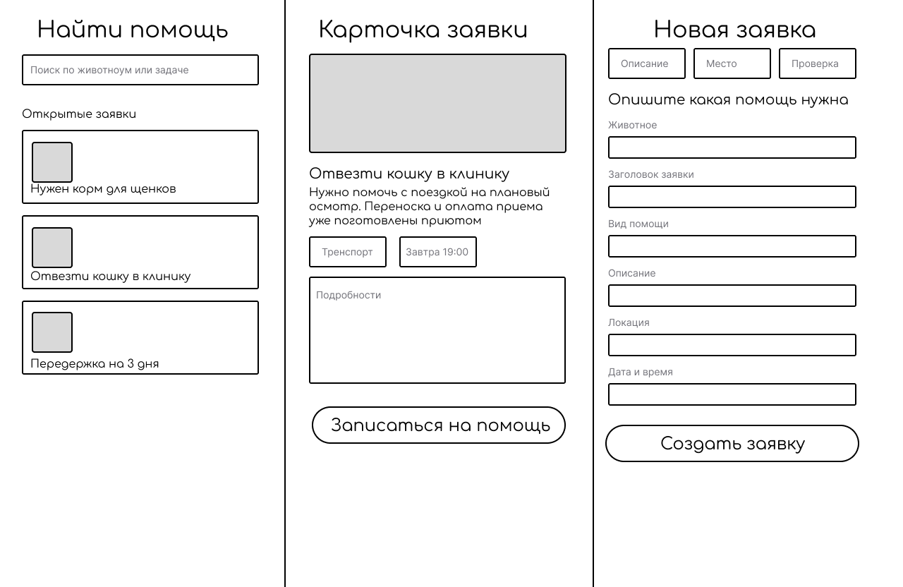
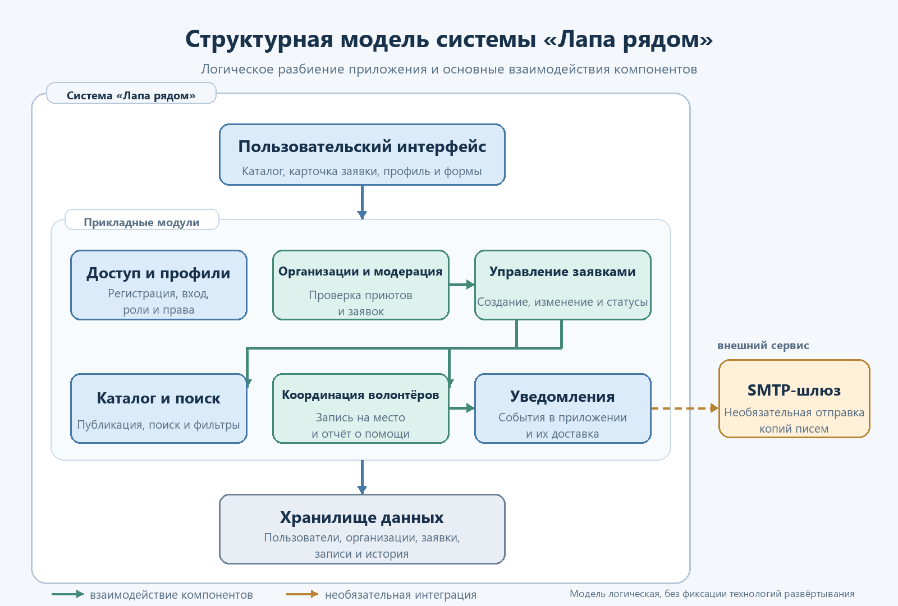

# Спецификация требований к программному обеспечению (SRS)

## «Лапа рядом» — система волонтёрской помощи животным

**Версия:** 0.3 
**Автор:** Кирилл Угрумов, группа 450504 
**Дата:** 10.11.2026 
**Язык документации:** русский

## Оглавление

- [История изменений](#история-изменений)
- [1. Введение](#1-введение)
  - [1.1 Назначение документа](#11-назначение-документа)
  - [1.2 Область применения продукта](#12-область-применения-продукта)
  - [1.3 Термины и сокращения](#13-термины-и-сокращения)
  - [1.4 Ссылки](#14-ссылки)
  - [1.5 Обзор документа](#15-обзор-документа)
  - [1.6 Бизнес-требования](#16-бизнес-требования)
- [2. Обзор продукта](#2-обзор-продукта)
  - [2.1 Перспектива продукта](#21-перспектива-продукта)
  - [2.2 Функции продукта](#22-функции-продукта)
  - [2.3 Ограничения продукта](#23-ограничения-продукта)
  - [2.4 Характеристики пользователей](#24-характеристики-пользователей)
  - [2.5 Допущения и зависимости](#25-допущения-и-зависимости)
  - [2.6 Распределение требований](#26-распределение-требований)
- [3. Требования](#3-требования)
  - [3.1 Внешние интерфейсы](#31-внешние-интерфейсы)
  - [3.2 Функциональные требования](#32-функциональные-требования)
  - [3.3 Качество обслуживания](#33-качество-обслуживания)
  - [3.4 Соответствие и обработка данных](#34-соответствие-и-обработка-данных)
  - [3.5 Проектирование и реализация](#35-проектирование-и-реализация)
  - [3.6 ИИ/МО](#36-имо)
- [4. Верификация](#4-верификация)
- [5. Приложения](#5-приложения)
  - [Приложение A. Статусы заявки](#приложение-a-статусы-заявки)
  - [Приложение B. Индивидуальное выполнение](#приложение-b-индивидуальное-выполнение)
  - [Приложение C. Структурная компонентная модель](#приложение-c-структурная-компонентная-модель)

## История изменений

| Версия | Дата | Автор | Изменение |
|---|---|---|---|
| 0.1 | 09.11.2026 | Кирилл Угрумов | Первичный вариант: бизнес-цели, границы продукта, требования и макет ключевых экранов. |
| 0.2 | 10.11.2026 | Кирилл Угрумов | Добавлен авторский макет PNG и прямая иллюстрация в разделе пользовательского интерфейса. |
| 0.3 | 10.11.2026 | Кирилл Угрумов | Добавлено приложение C с логической компонентной моделью SysML v2 и схемой взаимодействий. |

---

## 1. Введение

«Лапа рядом» — учебный проект веб-системы для координации проверенных заявок о помощи животным. Документ фиксирует ожидаемые функции, границы и измеримые критерии приёмки MVP. Он предназначен для автора проекта, преподавателя, разработчиков и тех, кто будет проверять требования.

### 1.1 Назначение документа

SRS описывает, **что** должна делать система «Лапа рядом» и как проверить выполнение требований. Документ служит исходной точкой для проектирования, реализации, демонстрации и обсуждения изменений. Он не закрепляет окончательную архитектуру и будет уточняться после обратной связи преподавателя.

### 1.2 Область применения продукта

Первая версия — адаптивное веб-приложение, в котором проверенные представители приютов публикуют заявки, а волонтёры находят подходящую помощь, записываются на неё и отмечают выполнение. Координатор приюта подтверждает результат и управляет статусом заявки. Цель продукта — сократить время между появлением потребности и откликом волонтёра, а также сделать ход помощи понятным участникам.

В MVP входят профили и роли, каталог заявок, фильтры, публикация и модерация заявок, запись на ограниченное число мест, уведомления и фиксация результата. В MVP **не входят** денежные сборы и платежи, ветеринарная диагностика, экстренная диспетчеризация, пристройство животных и проверка личности волонтёров вне возможностей учебного прототипа.

### 1.3 Термины и сокращения

| Термин | Определение |
|---|---|
| Заявка | Опубликованная потребность в конкретной помощи животному или приюту с описанием, сроком и доступными местами. |
| Волонтёр | Зарегистрированный пользователь, который выбирает заявку и берёт на себя одну из доступных задач. |
| Представитель приюта | Пользователь, чья принадлежность к организации подтверждена администратором; может создавать и вести заявки этой организации. |
| Координатор | Представитель приюта, отвечающий за связь с волонтёрами и подтверждение выполнения помощи. |
| Место | Одна доступная возможность принять участие в заявке. Число мест ограничивает число одновременных волонтёров. |
| Модерация | Проверка организации или заявки администратором до её публикации. |
| MVP | Минимально жизнеспособная версия продукта, предназначенная для демонстрации основных сценариев. |
| SRS | Software Requirements Specification — спецификация требований к программному обеспечению. |
| SysML v2 | Systems Modeling Language, версия 2; язык системного моделирования. |
| UI | User Interface — пользовательский интерфейс приложения. |

### 1.4 Ссылки

| Источник | Назначение | Тип |
|---|---|---|
| `srs/srs-template.md` в репозитории | Шаблон SRS курса | Рекомендательный |
| `docs/standards.md` в репозитории | Справка по стандартам инженерии требований | Рекомендательный |
| Методические указания к лабораторной работе № 3, предоставленные студентом | Состав задания и контрольные вопросы | Нормативный для лабораторной работы |
| [Спецификация SysML v2, OMG](https://www.omg.org/spec/SysML/2.0) | Синтаксис моделей системы и пользовательского интерфейса | Справочный |
| [Авторский макет пользовательского интерфейса](../lab3/ui-prototype-user.png) и [модель SysML v2](../lab3/ui-prototype.sysml) | Эскиз ключевых экранов и его текстовая модель | Артефакты проекта |
| [Компонентная модель SysML v2](../lab3/system-architecture.sysml) и [схема архитектуры PNG](../lab3/system-architecture.png) | Логические модули системы и их взаимодействия | Артефакты проекта |

### 1.5 Обзор документа

Раздел 2 описывает контекст, пользователей и рамки продукта. Раздел 3 задаёт проверяемые требования с уникальными ID. Раздел 4 связывает каждое требование со способом проверки. Раздел 5 содержит статусы заявки, сведения об индивидуальном формате и логическую компонентную модель приложения. Изменения фиксируются в таблице истории и при необходимости сопровождаются пересмотром критериев приёмки.

### 1.6 Бизнес-требования

| ID | Бизнес-требование | Критерий успеха на уровне продукта |
|---|---|---|
| BR-001 | Приют должен иметь единое место для публикации конкретных потребностей в помощи животным. | Представитель приюта может создать заявку со сроком, видом помощи, описанием и числом мест; заявка проходит модерацию. |
| BR-002 | Волонтёр должен находить подходящие заявки без просмотра несвязанных объявлений. | В каталоге доступны поиск и фильтрация по городу, виду помощи, сроку и статусу. |
| BR-003 | Участники должны видеть, кто взял заявку и на каком она этапе. | Для каждой заявки отображаются статус, заполненность мест и история основных изменений. |
| BR-004 | Контактные данные и точный адрес не должны быть открыты посетителям без необходимости. | Публичная карточка показывает только общую локацию; контакт для координации доступен волонтёру после записи и координатору. |
| BR-005 | Система должна поддерживать выполнение помощи без денежных транзакций. | Основной сценарий можно пройти от публикации до подтверждения помощи без платежей и финансовых данных. |

При сборе фактических бизнес-показателей (например, времени до первого отклика и доли закрытых заявок) нужны данные приюта. В учебном MVP такие показатели можно фиксировать как будущие метрики, но нельзя заявлять измеренные результаты без пилотной эксплуатации.

---

## 2. Обзор продукта

### 2.1 Перспектива продукта

«Лапа рядом» — новый самостоятельный учебный веб-продукт. База данных является источником записей о пользователях, организациях, животных, заявках и откликах. Пользователи работают через браузер. Внешняя почтовая служба может использоваться для дублирования уведомлений, но основной сценарий не должен зависеть от неё. Карты и геолокация в MVP не используются.

### 2.2 Функции продукта

- просмотр опубликованных заявок;
- поиск и фильтрация по городу, виду помощи, сроку и срочности;
- регистрация волонтёра и управление профилем;
- создание заявок подтверждёнными представителями приютов;
- проверка приютов и модерация новых заявок администратором;
- запись волонтёра на свободное место и отказ от записи;
- изменение статуса заявки и подтверждение выполненной помощи;
- уведомления об изменениях, влияющих на участников;
- просмотр основных событий по заявке.

### 2.3 Ограничения продукта

1. Тип продукта — адаптивное веб-приложение; отдельные приложения для Android и iOS в границы MVP не входят.
2. Целевой сценарий — работа приютов и волонтёров в пределах одного города, настраиваемого при развёртывании.
3. Язык интерфейса и документации — русский. Основной язык реализации — Java; предпочтительный серверный стек — Spring Boot, PostgreSQL и серверные HTML-шаблоны с CSS/Bootstrap. Конкретные версии библиотек уточняются перед реализацией.
4. Внешние сервисы не обязательны для основных сценариев. SMTP может подключаться для отправки копий уведомлений; при его недоступности пользователь видит уведомления в приложении. Внешний картографический API и платёжные сервисы не входят в MVP.
5. Публиковать заявки могут только представители подтверждённых организаций. Неподтверждённые заявки не видны в открытом каталоге.
6. Система координирует добровольную помощь, но не гарантирует медицинский или экстренный результат. Срочная метка не заменяет обращение в профильные службы.
7. Все критерии производительности ниже относятся к тестовому окружению учебного MVP, а не к SLA публичного сервиса.

### 2.4 Характеристики пользователей

| Роль | Цель | Уровень подготовки и доступ |
|---|---|---|
| Посетитель | Понять, какая помощь нужна, и изучить открытые заявки. | Не обязан разбираться в ИТ; видит только публичные сведения, не может откликаться. |
| Волонтёр | Найти подходящую задачу, записаться и сообщить о выполнении. | Базовые навыки работы с браузером; видит свои записи и необходимую для координации контактную информацию. |
| Представитель приюта / координатор | Публиковать потребности, вести участников и подтверждать результат. | Базовые навыки браузера; права выдаются после проверки организации. |
| Администратор | Проверять организации и заявки, блокировать злоупотребления. | Доверенная роль; доступ к операциям модерации и журналу изменений. |

### 2.5 Допущения и зависимости

| ID | Допущение или зависимость | Если неверно |
|---|---|---|
| A-01 | Для учебной демонстрации достаточно одного города и ограниченного набора демонстрационных заявок. | Потребуются настройки нескольких городов и дополнительные сценарии фильтрации. |
| A-02 | Приюты согласны назначить ответственного координатора для подтверждения заявок и закрытия задач. | Нужны альтернативные правила проверки и эскалации просроченных заявок. |
| A-03 | Пользователь имеет современный браузер и доступ в интернет. | Необходимы требования для офлайн-режима или дополнительных платформ. |
| A-04 | Почтовые уведомления могут быть отключены в демонстрационной среде. | Нужно настроить SMTP и хранить секреты отдельно от исходного кода. |
| A-05 | Пользователи не размещают в заявках медицинские диагнозы, чужие контакты и данные, не нужные для координации. | Понадобятся дополнительные правила модерации и обработки жалоб. |

### 2.6 Распределение требований

| Инкремент | Содержание | Основные требования |
|---|---|---|
| I1 — прототип и каталог | Макет, публичный каталог, карточка заявки, основные правила интерфейса. | REQ-INT-001, REQ-FUNC-001, REQ-FUNC-002 |
| I2 — пользователи и публикация | Учётные записи, профили, проверка организации, создание и модерация заявок. | REQ-FUNC-003–REQ-FUNC-008 |
| I3 — координация помощи | Запись на место, статусы, выполнение, уведомления и журнал событий. | REQ-FUNC-009–REQ-FUNC-016 |
| Сквозные требования | Безопасность, производительность, установка, сопровождение и приёмка. | Разделы 3.3–3.5 |

---

## 3. Требования

Все требования в этом разделе имеют приоритет **Must** для учебного MVP, если в описании не указано иное. ID уникальны и используются в матрице верификации. Критерии приёмки относятся к системе в заданном тестовом окружении.

### 3.1 Внешние интерфейсы

#### 3.1.1 Пользовательские интерфейсы

**REQ-INT-001 — Адаптивный веб-интерфейс** 
Система должна предоставлять русскоязычные страницы каталога, карточки заявки, профиля, управления заявками и модерации. Основные сценарии должны быть доступны при ширине окна от 360 до 1440 CSS-пикселей. Поля формы должны иметь подписи, понятные сообщения об ошибках и обозначение обязательности.

- **Обоснование:** пользователи могут открывать систему с телефона и компьютера.
- **Критерий приёмки:** каталог и формы остаются читаемыми при ширине 360 px и 1366 px; обязательное поле и ошибка проверки различимы без опоры только на цвет.
- **Проверка:** демонстрация и инспекция.
- **Связанные материалы:** [авторский макет PNG](../lab3/ui-prototype-user.png), [SysML v2](../lab3/ui-prototype.sysml).

*Рисунок 1 – Авторский макет интерфейса.*

**REQ-INT-002 — Показ локации и контактных данных** 
В публичной карточке система должна показывать город или район, но не точный адрес и не частные контактные данные. После успешной записи волонтёра на заявку система должна показывать ему контакт координатора и подробности встречи, необходимые для выполнения задачи.

- **Обоснование:** ограничить раскрытие данных участниками, которым они нужны.
- **Критерий приёмки:** посетитель и не записанный волонтёр не видят точный адрес и приватные контакты; назначенный волонтёр и координатор видят их в карточке заявки.
- **Проверка:** тестирование ролей.

**REQ-INT-003 — Почтовые уведомления** 
При настроенном SMTP система должна отправлять копии ключевых уведомлений на адрес участника. Ошибка почтовой службы не должна отменять успешно сохранённое действие; уведомление остаётся доступным в приложении.

- **Обоснование:** письмо упрощает координацию, но не является обязательной зависимостью основного сценария.
- **Критерий приёмки:** при недоступном SMTP заявка/отклик сохраняется, в приложении отображается уведомление или статус ошибки отправки без повторного создания действия.
- **Проверка:** тестирование с доступной и недоступной тестовой почтовой службой.

#### 3.1.2 Аппаратные интерфейсы

Специализированные аппаратные устройства не требуются. Для добавления фотографии животного пользователь выбирает файл через стандартный системный диалог браузера. Работа с камерой в реальном времени, принтерами, GPS-датчиками и сканерами не входит в MVP.

#### 3.1.3 Программные интерфейсы

- Браузер обращается к веб-приложению по HTTPS при публичном развёртывании.
- Сервер хранит данные пользователей, организаций, животных, заявок, откликов и уведомлений в PostgreSQL.
- SMTP-интеграция настраивается через внешнюю конфигурацию; пароль SMTP не хранится в репозитории.
- В MVP нет обязательного публичного API, картографического API, платёжного API или интеграции с мессенджером.

### 3.2 Функциональные требования

#### Каталог и учётные записи

**REQ-FUNC-001 — Просмотр и фильтрация каталога** 
Система должна показывать опубликованные и не закрытые заявки. Посетитель должен иметь возможность искать по тексту и фильтровать по городу, категории помощи, сроку и срочности.

- **Критерий приёмки:** каждый результат соответствует заданным фильтрам; заявка в черновике, на проверке или отменённая в публичном списке не появляется.
- **Проверка:** тестирование с набором заявок для положительных, пустых и смешанных фильтров.

**REQ-FUNC-002 — Просмотр карточки заявки** 
Система должна показывать вид помощи, описание, животное или группу животных, общий район, срок, срочность, число свободных мест и статус заявки. Приватные контакты и точный адрес отображаются по правилам REQ-INT-002.

- **Критерий приёмки:** из карточки каталога можно открыть подробности; значения статуса и свободных мест совпадают с сохранённой заявкой.
- **Проверка:** тестирование и инспекция.

**REQ-FUNC-003 — Регистрация и вход пользователя** 
Система должна позволять пользователю создать учётную запись с ролью волонтёра или представителя приюта, уникальным адресом электронной почты и паролем, войти и завершить сеанс. Выбор роли представителя сам по себе не подтверждает организацию и не даёт права публиковать заявки.

- **Критерий приёмки:** повторный адрес электронной почты отклоняется; неверная пара учётных данных не создаёт сеанс; неподтверждённый представитель не может публиковать заявки; после выхода защищённая страница требует повторного входа.
- **Проверка:** тестирование.

**REQ-FUNC-004 — Профиль и предпочтения волонтёра** 
Система должна позволять волонтёру просматривать и редактировать имя для отображения, город, предпочтительные категории помощи и контакт для координации. Система должна показывать волонтёру список его текущих и завершённых записей.

- **Критерий приёмки:** после сохранения новые значения отображаются в профиле; пользователь не может редактировать профиль другого пользователя.
- **Проверка:** тестирование ролей.

#### Организации и публикация заявок

**REQ-FUNC-005 — Запрос на подтверждение организации** 
Пользователь, представляющий приют, должен иметь возможность передать администратору название организации, общую контактную информацию и сведения для проверки. До подтверждения организации публикация открытых заявок запрещена.

- **Критерий приёмки:** новая организация имеет статус «На проверке»; её представитель не может опубликовать заявку до подтверждения.
- **Проверка:** тестирование.

**REQ-FUNC-006 — Создание и редактирование заявки** 
Подтверждённый представитель приюта должен иметь возможность создать и редактировать черновик заявки, а затем отправить его на модерацию. Обязательные поля: заголовок, категория помощи, описание, общий район, срок актуальности, число мест (от 1 до 20) и способ связи с координатором.

- **Критерий приёмки:** неполная форма не отправляется на модерацию; при корректных значениях черновик сохраняется, а подтверждённый представитель может передать его администратору на проверку.
- **Проверка:** тестирование граничных значений и инспекция формы.

**REQ-FUNC-007 — Проверка полей заявки** 
Система должна отклонять заявку с пустыми обязательными полями, сроком в прошлом, числом мест меньше одного или больше 20. Система должна сообщать, какие поля требуется исправить.

- **Критерий приёмки:** каждый некорректный пример отклоняется с сообщением у соответствующего поля; корректный пример сохраняется.
- **Проверка:** тестирование граничных значений.

**REQ-FUNC-008 — Модерация организаций и заявок** 
Администратор должен иметь возможность подтвердить или отклонить организацию, проверить поданную заявку и одобрить её публикацию либо вернуть на исправление с комментарием.

- **Критерий приёмки:** решение модератора и комментарий сохраняются; только одобренная заявка подтверждённой организации отображается в открытом каталоге.
- **Проверка:** тестирование ролей и состояний.

#### Запись и выполнение помощи

**REQ-FUNC-009 — Запись волонтёра на свободное место** 
Вошедший волонтёр должен иметь возможность записаться на заявку со статусом «Опубликована» или «В работе», если в ней есть свободное место. Система должна атомарно уменьшить число свободных мест и не допускать записи одного волонтёра на одну заявку более одного раза.

- **Критерий приёмки:** после успешной записи доступное число мест уменьшается на единицу; заявка со статусом «В работе» принимает дополнительные записи, пока есть свободные места; при одновременной попытке занять последнее место подтверждается только одна запись.
- **Проверка:** тестирование конкурентных попыток.

**REQ-FUNC-010 — Отказ от записи** 
Волонтёр должен иметь возможность отказаться от записи до её завершения. Система должна сохранить факт отмены и вернуть место в доступные, если координатор не закрыл заявку.

- **Критерий приёмки:** после отмены активная запись отсутствует, место доступно следующему волонтёру, а координатор видит отмену.
- **Проверка:** тестирование переходов состояния.

**REQ-FUNC-011 — Управление жизненным циклом заявки** 
Система должна поддерживать состояния «Черновик», «На проверке», «Опубликована», «В работе», «Выполнена», «Отменена» и «Срок истёк». После первой успешной записи волонтёра опубликованная заявка переходит в состояние «В работе»; это состояние допускает новые записи при наличии мест. Изменять состояние могут только пользователи с соответствующими правами.

- **Критерий приёмки:** переходы соответствуют диаграмме в приложении A; закрытую заявку нельзя записать или повторно опубликовать без редактирования и новой проверки.
- **Проверка:** тестирование переходов и ролей.

**REQ-FUNC-012 — Отчёт волонтёра о выполнении** 
Записанный волонтёр должен иметь возможность отметить свою задачу как выполненную и добавить текстовый комментарий и, при необходимости, фотографию.

- **Критерий приёмки:** отчёт связан с конкретной записью и имеет дату; другой волонтёр не может изменить его.
- **Проверка:** тестирование ролей и инспекция сохранённых данных.

**REQ-FUNC-013 — Подтверждение результата координатором** 
Координатор должен иметь возможность подтвердить выполнение либо вернуть отчёт волонтёру на уточнение. Если у заявки не осталось невыполненных записей и все результаты подтверждены, система должна позволить закрыть заявку как выполненную.

- **Критерий приёмки:** результат становится подтверждённым только после действия координатора; заявка не закрывается выполненной при наличии незавершённой записи.
- **Проверка:** тестирование состояний и ролей.

**REQ-FUNC-014 — Уведомления об изменениях** 
Система должна создавать уведомление участникам при записи или отмене записи, изменении срока или статуса заявки, запросе уточнения и подтверждении результата.

- **Критерий приёмки:** для каждого перечисленного события соответствующие участники получают уведомление в приложении; пользователи, не связанные с заявкой, его не получают.
- **Проверка:** тестирование событий и адресатов.

**REQ-FUNC-015 — История заявки** 
Система должна сохранять автора и время основных действий: отправки на проверку, публикации, записи и отмены волонтёра, изменения статуса и подтверждения выполнения.

- **Критерий приёмки:** координатор и администратор могут просмотреть события заявки в хронологическом порядке; обычный пользователь не может изменить историю.
- **Проверка:** тестирование и инспекция.

**REQ-FUNC-016 — Жалоба на заявку** 
Посетитель или волонтёр должен иметь возможность отправить администратору жалобу на опубликованную заявку с категорией и пояснением. Администратор должен иметь возможность скрыть заявку до завершения проверки.

- **Критерий приёмки:** жалоба создаёт запись, доступную администратору; действие сокрытия сразу исключает заявку из публичного каталога.
- **Проверка:** демонстрация и тестирование ролей.

### 3.3 Качество обслуживания

#### 3.3.1 Производительность

**REQ-PERF-001 — Время ответа каталога** 
При объёме до 1 000 активных заявок и до 20 одновременных тестовых пользователей выдача каталога и фильтров должна завершаться не более чем за 2 секунды в 95-м процентиле на согласованном тестовом окружении.

- **Критерий приёмки:** измерение не менее 100 запросов каталога; 95-й процентиль не превышает 2 секунды.
- **Проверка:** измерение/анализ.

#### 3.3.2 Безопасность

**REQ-SEC-001 — Контроль доступа по ролям** 
Система должна проверять права пользователя на серверной стороне для каждой операции создания, изменения, публикации, записи, модерации и закрытия заявки.

- **Критерий приёмки:** прямой запрос от пользователя без нужной роли не изменяет данные и возвращает отказ.
- **Проверка:** тестирование ролей.

**REQ-SEC-002 — Защита учётных данных** 
Система не должна хранить пароль в открытом виде и не должна включать секреты SMTP или другие рабочие ключи в исходный код. Публичное развёртывание должно обслуживаться через HTTPS.

- **Критерий приёмки:** проверка хранилища подтверждает отсутствие открытых паролей; секреты задаются конфигурацией окружения; публичный URL использует HTTPS.
- **Проверка:** инспекция и анализ конфигурации.

**REQ-SEC-003 — Минимизация раскрытия персональных данных** 
Система должна показывать адрес электронной почты, телефон, точный адрес встречи и иные контактные данные только владельцу профиля, назначенному волонтёру, соответствующему координатору и администратору.

- **Критерий приёмки:** публичный каталог, поиск и экспорт не содержат закрытые поля; пользователь другой заявки не получает к ним доступ.
- **Проверка:** тестирование ролей и инспекция ответов приложения.

#### 3.3.3 Надёжность

**REQ-REL-001 — Согласованность записи на место** 
При одновременных запросах на последнее свободное место система должна сохранять не больше одной активной записи на это место и не допускать отрицательного числа свободных мест.

- **Критерий приёмки:** при серии параллельных запросов выполнен только допустимый объём записей; итоговые данные согласованы.
- **Проверка:** тестирование конкурентных операций.

#### 3.3.4 Доступность

**REQ-AVAIL-001 — Сохранность данных при перезапуске** 
После штатного перезапуска приложения сохранённые пользователи, заявки, отклики и история должны оставаться доступны. Если временно недоступен SMTP, основной сценарий публикации и записи должен продолжать работать.

- **Критерий приёмки:** созданные до перезапуска записи доступны после запуска; тест с отключённым SMTP не теряет заявку или отклик.
- **Проверка:** демонстрация и тестирование.

#### 3.3.5 Наблюдаемость

**REQ-OBS-001 — Журнал ошибок и операций** 
Система должна журналировать ошибки сохранения, отказ в доступе, ошибки отправки уведомлений и изменения статусов с датой, типом операции и идентификатором объекта. Журнал не должен содержать пароль, токен сессии или полный текст приватных контактов.

- **Критерий приёмки:** для перечисленных событий создана запись с идентификатором заявки или пользователя; секретные поля отсутствуют.
- **Проверка:** инспекция журналов.

### 3.4 Соответствие и обработка данных

**REQ-COMP-001 — Согласие и удаление профиля** 
До сохранения контактных данных система должна информировать пользователя об их назначении. Пользователь должен иметь возможность запросить удаление профиля; связанные записи заявок должны обезличиваться или сохраняться только в объёме, необходимом для целостной истории проекта.

- **Критерий приёмки:** экран регистрации содержит уведомление о цели обработки; запрос удаления удаляет или обезличивает поля профиля по определённому правилу.
- **Проверка:** инспекция и демонстрация.

Для публичного запуска владелец продукта должен отдельно проверить применимые требования к обработке персональных данных и правила приютов. Настоящий учебный документ не является юридическим заключением.

### 3.5 Проектирование и реализация

**REQ-INST-001 — Локальный запуск** 
Репозиторий должен содержать инструкцию по настройке, запуску и остановке приложения, а также перечень необходимых зависимостей и конфигурации базы данных.

- **Критерий приёмки:** разработчик, знакомый с Java, может выполнить шаги README на чистом рабочем окружении и открыть стартовую страницу.
- **Проверка:** демонстрация по инструкции.

**REQ-BUILD-001 — Повторяемая сборка** 
Проект должен собираться стандартным инструментом сборки Java из исходного кода с фиксированными версиями прямых зависимостей. Конфигурация запуска и тестовые данные не должны требовать внешних платных сервисов.

- **Критерий приёмки:** сборка выполняется из чистого клона репозитория; секреты и локальные файлы не требуются.
- **Проверка:** демонстрация и инспекция.

**REQ-MAINT-001 — Сопровождаемая структура** 
Исходный код должен разделять работу с веб-запросами, бизнес-правила, хранение данных и представление. Инструкция по проекту должна описывать роли, статусы заявки и конфигурацию внешней почты.

- **Критерий приёмки:** описание структуры и основных статусов присутствует в документации репозитория.
- **Проверка:** инспекция.

**REQ-PORT-001 — Поддержка браузеров и ширины окна** 
В рамках приёмки основные сценарии должны быть доступны в актуальных стабильных версиях Chromium-браузера и Firefox, а также при ширине окна 360 px и 1366 px.

- **Критерий приёмки:** каталог, карточка заявки, вход и создание заявки работают без потери доступности основных элементов.
- **Проверка:** демонстрация.

**REQ-COST-001 — Отсутствие обязательных платных интеграций** 
Демонстрационный MVP должен запускаться без оплачиваемых API, картографических сервисов и платёжных систем. Почтовая интеграция должна оставаться отключаемой.

- **Критерий приёмки:** основные сценарии демонстрируются при отключённых внешних интеграциях.
- **Проверка:** демонстрация и анализ состава зависимостей.

**REQ-POC-001 — Сквозная демонстрация MVP** 
В прототипе должна быть возможна демонстрация сценария: администратор подтверждает организацию, координатор подаёт заявку, волонтёр записывается, отмечает выполнение, координатор подтверждает результат.

- **Критерий приёмки:** сценарий проходит на тестовых учётных записях без ручного изменения базы данных во время демонстрации.
- **Проверка:** демонстрация.

**REQ-CM-001 — Управление изменениями требований** 
Изменение требования должно иметь ID, краткое обоснование, оценку влияния на связанные требования и запись в истории версий SRS. Отклонённое предложение должно иметь зафиксированную причину.

- **Критерий приёмки:** для каждого принятого изменения заполнена запись истории; затронутые критерии приёмки пересмотрены.
- **Проверка:** инспекция.

Повторно используемые программные компоненты, распределённая топология, отдельные мобильные приложения и точная дата публичного запуска для учебного MVP не назначаются. Эти темы могут быть пересмотрены при изменении области применения.

### 3.6 ИИ/МО

ИИ/МО не используется для публикации, ранжирования, проверки заявок или принятия решений о доступе. Рекомендации и автоматическое распознавание животных не входят в MVP; требования этого подраздела неприменимы.

---

## 4. Верификация

Статус всех требований в первой версии — **запланировано**. Наличие макета проверяет интерфейсные ожидания, но не является доказательством выполнения программного требования. Ссылки на тестовые артефакты будут добавляться по мере реализации.

| ID требования | Метод проверки | Артефакт или критерий | Статус |
|---|---|---|---|
| REQ-INT-001 | Демонстрация, инспекция | Макет и фактические страницы на 360 px и 1366 px | Запланировано |
| REQ-INT-002 | Тестирование ролей | Сравнение публичного и авторизованного просмотра | Запланировано |
| REQ-INT-003 | Тестирование | SMTP включён/отключён; сохранение основного действия | Запланировано |
| REQ-FUNC-001 | Тестирование | Каталог и положительные/пустые фильтры | Запланировано |
| REQ-FUNC-002 | Тестирование, инспекция | Карточка опубликованной заявки | Запланировано |
| REQ-FUNC-003 | Тестирование | Уникальность адреса, вход, выход | Запланировано |
| REQ-FUNC-004 | Тестирование ролей | Редактирование профиля и список записей | Запланировано |
| REQ-FUNC-005 | Тестирование | Статус организации до подтверждения | Запланировано |
| REQ-FUNC-006 | Тестирование | Сохранение черновика заявки | Запланировано |
| REQ-FUNC-007 | Тестирование граничных значений | Неверный срок, пустые поля, число мест | Запланировано |
| REQ-FUNC-008 | Тестирование ролей | Одобрение, отклонение, возврат на доработку | Запланировано |
| REQ-FUNC-009 | Конкурентное тестирование | Две попытки занять последнее место | Запланировано |
| REQ-FUNC-010 | Тестирование состояний | Отмена записи и возврат места | Запланировано |
| REQ-FUNC-011 | Тестирование переходов | Матрица разрешённых статусов | Запланировано |
| REQ-FUNC-012 | Тестирование ролей | Отчёт по своей и чужой записи | Запланировано |
| REQ-FUNC-013 | Тестирование состояний | Подтверждение, возврат, закрытие заявки | Запланировано |
| REQ-FUNC-014 | Тестирование | Уведомления и правильные адресаты | Запланировано |
| REQ-FUNC-015 | Инспекция, тестирование | История по заявке и запрет её редактирования | Запланировано |
| REQ-FUNC-016 | Демонстрация, тестирование ролей | Жалоба и сокрытие заявки | Запланировано |
| REQ-PERF-001 | Измерение | 100 запросов каталога, нагрузка до 20 пользователей | Запланировано |
| REQ-SEC-001 | Тестирование ролей | Попытки запрещённых серверных операций | Запланировано |
| REQ-SEC-002 | Инспекция | Хранилище паролей и конфигурация секретов | Запланировано |
| REQ-SEC-003 | Тестирование ролей | Публичный ответ и доступ после записи | Запланировано |
| REQ-REL-001 | Конкурентное тестирование | Параллельное распределение последнего места | Запланировано |
| REQ-AVAIL-001 | Демонстрация | Перезапуск и работа без SMTP | Запланировано |
| REQ-OBS-001 | Инспекция | Журнал событий без секретных значений | Запланировано |
| REQ-COMP-001 | Инспекция, демонстрация | Уведомление о цели данных и обработка удаления | Запланировано |
| REQ-INST-001 | Демонстрация | Запуск по инструкции из чистого клона | Запланировано |
| REQ-BUILD-001 | Инспекция, демонстрация | Сборка проекта без внешнего платного сервиса | Запланировано |
| REQ-MAINT-001 | Инспекция | Структура кода и документация | Запланировано |
| REQ-PORT-001 | Демонстрация | Браузер и контрольные ширины окна | Запланировано |
| REQ-COST-001 | Демонстрация, анализ | Основные сценарии без платных API | Запланировано |
| REQ-POC-001 | Сквозная демонстрация | Сценарий от проверки организации до закрытия заявки | Запланировано |
| REQ-CM-001 | Инспекция | История версий и обоснования изменений | Запланировано |

---

## 5. Приложения

### Приложение A. Статусы заявки

| Текущий статус | Разрешённый следующий статус | Инициатор |
|---|---|---|
| Черновик | На проверке, Отменена | Представитель приюта |
| На проверке | Опубликована, Черновик, Отменена | Администратор |
| Опубликована | В работе, Срок истёк, Отменена | Система или координатор |
| В работе | Выполнена, Опубликована, Срок истёк, Отменена | Координатор; система при истечении срока |
| Выполнена | — | Терминальное состояние |
| Отменена | — | Терминальное состояние; новая публикация требует новой проверки |
| Срок истёк | Черновик | Координатор может продлить срок через редактирование |

### Приложение B. Индивидуальное выполнение

Работа выполняется одним студентом, поэтому бизнес-цели и сценарии зафиксированы как проверяемые предположения, а не как дословные требования реального заказчика. На текущем этапе проведена самостоятельная проверка полноты и непротиворечивости документа. Отзыв преподавателя, замечания приюта и внешнего напарника здесь не моделируются. После получения реальных замечаний нужно внести только обоснованные изменения и добавить их в историю версий.

### Приложение C. Структурная компонентная модель

Для наглядного представления логического устройства приложения подготовлена компонентная модель SysML v2. Она дополняет требования и пользовательский макет: показывает основные части системы и связи между ними. Модель не закрепляет конкретную инфраструктуру или технологии развёртывания и сама по себе не вводит новые обязательные требования.

В системе выделены пользовательский интерфейс, управление доступом и профилями, проверка организаций и модерация заявок, управление заявками, каталог и поиск, координация волонтёров, уведомления и хранилище данных. SMTP-шлюз показан как необязательный внешний сервис: основные уведомления доступны внутри приложения, а отправка копий по электронной почте работает при наличии настроенной интеграции.

Основной сценарий проходит через эти модули следующим образом: представитель приюта создаёт заявку; она поступает на проверку организации и модерацию; после публикации появляется в каталоге; волонтёр находит заявку и записывается на свободное место; затем отмечает результат, а координатор подтверждает выполнение и завершает заявку. Система сохраняет сведения о заявке и её изменениях в хранилище и уведомляет участников о значимых событиях.

*Рисунок 2 – Структурная компонентная модель системы «Лапа рядом». Стрелки показывают логические взаимодействия компонентов; пунктиром отмечена необязательная интеграция с электронной почтой.*

Текстовое представление модели доступно в файле [system-architecture.sysml](../lab3/system-architecture.sysml).
